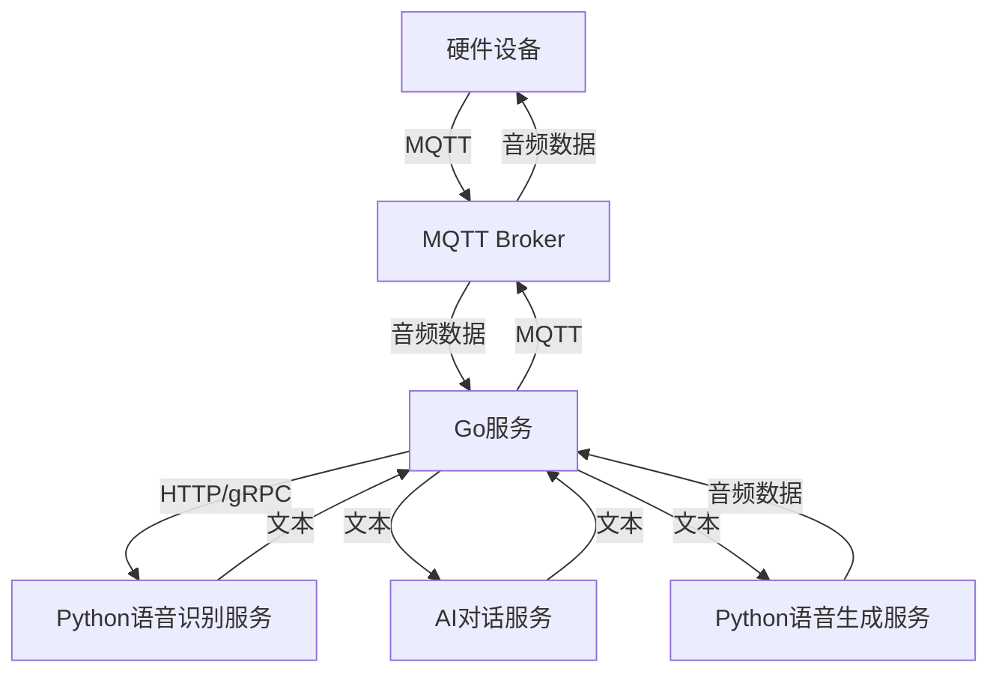

# 硬件集成技术方案设计文档

## 1. 系统架构

### 1.1 整体架构


### 1.2 核心组件
1. **MQTT服务**
   - Broker: EMQ X
   - 服务器地址: 127.0.0.1
   - 服务名: emqx
   - 端口配置:
     * MQTT协议端口: 28984
     * WebSocket端口: 28985
     * WebSocket SSL端口: 28986
     * MQTT SSL端口: 28987
     * 控制台端口: 28988
   - 协议: MQTT 3.1.1
   - QoS: 1

2. **Go主服务**
   - 框架: 现有TCP服务架构
   - MQTT客户端: paho.mqtt.golang
   - 音频处理: 流式处理

3. **Python语音服务**
   - 语音识别: Whisper/PaddleSpeech
   - 语音合成: VITS/FastSpeech2
   - 接口方式: gRPC

## 2. 通信协议

### 2.1 MQTT主题设计
```
设备音频输入: device/audio/input/{device_id}
设备音频输出: device/audio/output/{device_id}
设备状态: device/status/{device_id}
设备控制: device/control/{device_id}
系统通知: system/notice/{device_id}
```

### 2.2 音频数据格式
- 采样率: 16kHz
- 位深度: 16bit
- 通道数: 单通道
- 编码格式: PCM
- 分片大小: 20ms/片
- 数据格式: 二进制流

### 2.3 消息格式
```json
{
    "timestamp": 1679390859,
    "device_id": "device_001",
    "type": "audio",
    "format": {
        "sample_rate": 16000,
        "bit_depth": 16,
        "channels": 1,
        "encoding": "PCM"
    },
    "data": "base64_encoded_audio_data"
}
```

## 3. 数据流处理

### 3.1 音频输入流程
1. 设备采集音频
2. 音频分片处理
3. MQTT发送数据
4. Go服务接收并缓冲
5. 转发至语音识别服务
6. 文本结果进入AI处理

### 3.2 音频输出流程
1. AI生成文本响应
2. 文本转发至语音合成
3. 音频数据分片处理
4. MQTT推送至设备
5. 设备播放音频

## 4. 错误处理机制

### 4.1 网络错误
- MQTT断线重连: 30秒间隔
- 消息重试机制: 最大3次
- 会话保持: QoS 1

### 4.2 服务错误
- 语音服务降级方案
- AI服务超时处理
- 数据积压处理策略

### 4.3 设备错误
- 心跳检测: 60秒
- 状态恢复机制
- 错误日志上报

## 5. 性能指标

### 5.1 延迟指标
- 端到端延迟: < 1000ms
- 语音识别: < 300ms
- AI响应: < 500ms
- 语音合成: < 200ms

### 5.2 并发指标
- 单设备最大音频流: 64kbps
- 系统最大设备数: 1000
- MQTT最大连接数: 5000

## 6. 安全机制

### 6.1 认证授权
- MQTT认证: 用户名密码
- 设备认证: JWT
- API认证: Bearer Token

### 6.2 数据安全
- 传输加密: TLS 1.3
- 音频数据: AES-256
- 密钥管理: KMS

## 7. 监控告警

### 7.1 监控指标
- MQTT连接状态
- 音频流状态
- 服务响应时间
- 错误率统计

### 7.2 告警规则
- 设备离线: > 5分钟
- 服务错误率: > 1%
- 系统负载: > 80%

## 8. 部署架构

### 8.1 服务部署
- MQTT Broker: 主从架构
- Go服务: K8s部署
- Python服务: 独立部署

### 8.2 扩展策略
- 水平扩展: Pod自动扩缩容
- 负载均衡: 四层LB
- 数据存储: 分布式存储

## 9. 后续优化

### 9.1 短期优化
1. 音频压缩算法优化
2. 流量控制策略
3. 缓存机制优化

### 9.2 长期规划
1. 多语音模型支持
2. 实时音频降噪
3. 情感分析集成
