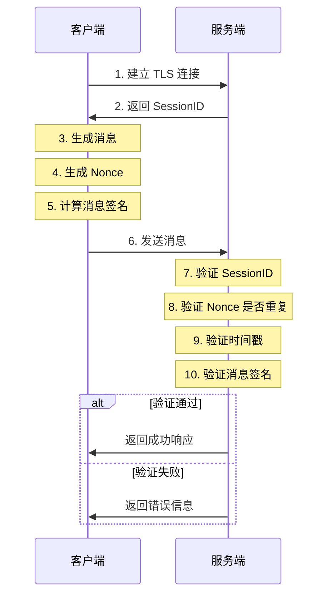

# TCP服务设计文档

## 1. TLS TCP服务端设计

### 1.1 服务端配置
```go
type TCPConfig struct {
    // 服务监听地址
    ListenAddr string `yaml:"listen_addr"`
    // TLS配置
    TLSConfig struct {
        CertFile string `yaml:"cert_file"` // 证书文件路径
        KeyFile  string `yaml:"key_file"`  // 私钥文件路径
    } `yaml:"tls_config"`
    // 连接配置
    ConnConfig struct {
        ReadTimeout  int64 `yaml:"read_timeout"`  // 读取超时时间(秒)
        WriteTimeout int64 `yaml:"write_timeout"` // 写入超时时间(秒)
        MaxConns     int   `yaml:"max_conns"`     // 最大连接数
    } `yaml:"conn_config"`
}
```

### 1.2 服务端启动流程
1. 加载TLS证书
2. 创建TLS配置
3. 启动监听服务
4. 接受新连接
5. 处理连接

```go
// 伪代码展示
func StartTCPServer(config *TCPConfig) error {
    // 1. 加载证书
    cert, err := tls.LoadX509KeyPair(config.TLSConfig.CertFile, config.TLSConfig.KeyFile)
    if err != nil {
        return err
    }

    // 2. TLS配置
    tlsConfig := &tls.Config{
        Certificates: []tls.Certificate{cert},
        MinVersion:  tls.VersionTLS12,
    }

    // 3. 启动监听
    listener, err := tls.Listen("tcp", config.ListenAddr, tlsConfig)
    if err != nil {
        return err
    }

    // 4. 接受连接
    for {
        conn, err := listener.Accept()
        if err != nil {
            continue
        }
        go handleConnection(conn)
    }
}
```

## 2. 客户端设计

### 2.1 客户端属性
```go
type Client struct {
    // 基础属性
    ID        string    // 客户端唯一标识
    UserID    int64     // 用户ID
    DeviceID  string    // 设备ID
    Platform  string    // 平台类型(ios/android/web)
    Version   string    // 客户端版本
    
    // 连接相关
    Conn      net.Conn  // TLS连接
    Connected bool      // 连接状态
    
    // 心跳相关
    LastPing  int64     // 最后心跳时间
    
    // 消息相关
    SendChan  chan []byte // 发送消息通道
    RecvChan  chan []byte // 接收消息通道
    
    // 统计信息
    ConnectedAt int64    // 连接建立时间
    MessageSent int64    // 发送消息数
    MessageRecv int64    // 接收消息数
}
```

### 2.2 连接流程
1. 客户端连接建立
```go
func Connect(addr string, tlsConfig *tls.Config) (*Client, error) {
    // 1. 建立TLS连接
    conn, err := tls.Dial("tcp", addr, tlsConfig)
    if err != nil {
        return nil, err
    }
    
    // 2. 创建客户端实例
    client := &Client{
        ID:         generateID(),
        Conn:       conn,
        Connected:  true,
        SendChan:   make(chan []byte, 1000),
        RecvChan:   make(chan []byte, 1000),
        ConnectedAt: time.Now().Unix(),
    }
    
    // 3. 启动收发协程
    go client.readLoop()
    go client.writeLoop()
    
    return client, nil
}
```

## 3. 消息处理设计

### 3.1 消息结构
```go
type Message struct {
    // 消息头
    Header struct {
        Version   uint8  // 协议版本
        Type      uint8  // 消息类型
        Sequence  uint32 // 序列号
        Timestamp int64  // 时间戳
        Length    uint32 // 消息体长度
    }
    // 消息体
    Body []byte
}
```

### 3.2 消息类型
```go
const (
    // 系统消息
    MsgTypeHeartbeat = 1  // 心跳
    MsgTypeAuth      = 2  // 认证
    MsgTypeKick      = 3  // 踢出
    
    // 业务消息
    MsgTypeChat      = 10 // 聊天消息
    MsgTypeNotify    = 11 // 通知消息
    MsgTypeAck       = 12 // 确认消息
)
```

### 3.3 双向消息发送流程

#### 3.3.1 发送流程
1. 消息打包
2. 写入发送通道
3. 发送协程处理

```go
func (c *Client) Send(msgType uint8, body []byte) error {
    // 1. 构建消息
    msg := &Message{
        Header: struct {
            Version   uint8
            Type      uint8
            Sequence  uint32
            Timestamp int64
            Length    uint32
        }{
            Version:   1,
            Type:      msgType,
            Sequence:  atomic.AddUint32(&sequence, 1),
            Timestamp: time.Now().Unix(),
            Length:    uint32(len(body)),
        },
        Body: body,
    }
    
    // 2. 打包消息
    data := msg.Pack()
    
    // 3. 写入发送通道
    select {
    case c.SendChan <- data:
        return nil
    default:
        return errors.New("send channel full")
    }
}
```

#### 3.3.2 接收流程
1. 读取消息头
2. 读取消息体
3. 消息解包
4. 处理消息

```go
func (c *Client) readLoop() {
    defer c.Close()
    
    for {
        // 1. 读取消息头
        header := make([]byte, HeaderSize)
        if _, err := io.ReadFull(c.Conn, header); err != nil {
            return
        }
        
        // 2. 解析消息头
        msg, err := UnpackHeader(header)
        if err != nil {
            return
        }
        
        // 3. 读取消息体
        body := make([]byte, msg.Header.Length)
        if _, err := io.ReadFull(c.Conn, body); err != nil {
            return
        }
        
        // 4. 处理消息
        c.handleMessage(msg.Header.Type, body)
    }
}

## 4. 安全设计

### 4.1 多层安全防护

#### 4.1.1 传输层安全(TLS)
- TLS加密保护传输层数据
- 防止数据被窃听
- 防止中间人攻击
- 保证数据完整性

#### 4.1.2 应用层安全(消息头防护)
1. 消息头安全字段：
```go
type MessageHeader struct {
    // 基本信息
    Version   uint8  // 协议版本号
    Type      uint8  // 消息类型
    Sequence  uint32 // 消息序列号
    Timestamp int64  // 消息时间戳
    Length    uint32 // 消息体长度

    // 安全相关
    SessionID string // 会话标识
    Nonce     uint64 // 随机数
    Signature string // 消息签名
}
```

2. 安全措施和防护目标：

| 安全字段 | 防护目标 | 实现方式 |
|------------|------------|------------|
| SessionID | 验证消息来源 | 连接建立时生成唯一会话标识 |
| Nonce | 防止重放攻击 | 基于时间戳生成的随机数 |
| Signature | 验证消息完整性 | HMAC-SHA256签名 |
| Timestamp | 验证消息新鲜度 | 时间戳校验 |

3. 安全验证流程：


4. 安全验证规则：
- SessionID验证：确保消息来自合法的已认证客户端
- Nonce验证：
  * 使用sync.Map存储已使用的nonce
  * 设置过期时间，自动清理过期的nonce
- 时间戳验证：
  * 消息必须在5分钟内送达
  * 超时消息直接丢弃
- 签名验证：
  * 使用HMAC-SHA256算法
  * 签名包含所有关键字段和消息体
    defer c.Close()

```go  
    for {
        // 1. 读取消息头
        header := make([]byte, HeaderSize)
        if _, err := io.ReadFull(c.Conn, header); err != nil {
            return
        }
        
        // 2. 解析消息头
        msg, err := UnpackHeader(header)
        if err != nil {
            return
        }
        
        // 3. 读取消息体
        body := make([]byte, msg.Header.Length)
        if _, err := io.ReadFull(c.Conn, body); err != nil {
            return
        }
        
        // 4. 处理消息
        c.handleMessage(msg.Header.Type, body)
    }
}
```

## 4. 心跳机制

### 4.1 心跳配置
```go
type HeartbeatConfig struct {
    Interval int64 // 心跳间隔(秒)
    Timeout  int64 // 心跳超时(秒)
}
```

### 4.2 心跳处理
1. 客户端定时发送心跳
2. 服务端更新最后心跳时间
3. 超时检测和断开处理

```go
func (c *Client) startHeartbeat(config HeartbeatConfig) {
    ticker := time.NewTicker(time.Duration(config.Interval) * time.Second)
    defer ticker.Stop()
    
    for {
        select {
        case <-ticker.C:
            // 发送心跳
            if err := c.Send(MsgTypeHeartbeat, nil); err != nil {
                return
            }
        }
    }
}
```

## 5. 错误处理

### 5.1 错误类型
```go
const (
    // 连接错误
    ErrConnClosed     = "connection closed"
    ErrConnTimeout    = "connection timeout"
    ErrTooManyConns   = "too many connections"
    
    // 消息错误
    ErrInvalidMessage = "invalid message"
    ErrMessageTooLong = "message too long"
    
    // 认证错误
    ErrAuthFailed     = "authentication failed"
    ErrTokenExpired   = "token expired"
)
```

### 5.2 错误处理策略
1. 连接错误：重试连接
2. 消息错误：丢弃消息
3. 认证错误：重新认证
4. 系统错误：记录日志并通知管理员

## 6. 性能优化

### 6.1 连接池管理
1. 使用连接池复用连接
2. 动态调整连接池大小
3. 定期清理空闲连接

### 6.2 消息缓冲
1. 使用环形缓冲区
2. 批量发送消息
3. 消息压缩

### 6.3 并发控制
1. 使用协程池处理连接
2. 限制最大并发连接数
3. 实现平滑关闭
